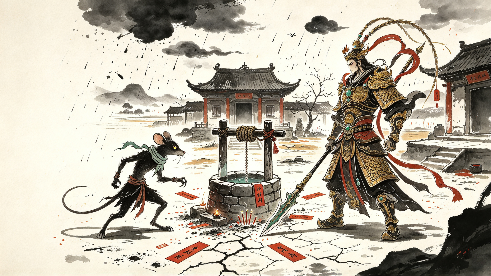

# 十二神相录

> 天书无名，人间有相

**2D 横版 1v1 动作 Roguelite** · PC · 键盘优先原型 · Godot 可玩纵向切片

十二生肖不是天庭敕封的神将，而是代表农户、百姓与普通劳动者的民间抵抗者。他们从不同方向共同进攻天庭，最终全部阵亡。鼠光战死后被死亡法则拖入黄泉，阎王借一纸「一次性还魂契」把他送回人间——代价是，此后每一轮，他都要借用一个仍然活着的凡人的身体。

---

## 项目简介

| 项目 | 内容 |
| --- | --- |
| 项目名称 | 十二神相录 |
| 类型 | 2D 横版 1v1 动作 Roguelite |
| 目标平台 | PC（优先手柄，支持键盘） |
| 项目阶段 | 六节点可玩 Demo / M7 表现完善 |
| 目标氛围 | 黑童话皮影、民间神话、黑暗悲剧、以弱抗强 |
| 核心卖点 | 生肖角色差异、武器与秘籍组合、活体寄身、旧我行为复制、双终局 |

**核心定位**：一屏横版 1v1 竞技场，战斗深度中等，能力层级为「站位与距离 → 精准格挡 → 武器切换」。

- **双资源**：*气* 用于防御、闪避与特殊移动；*势* 用于所有攻击，通过命中与精准格挡积攒，非攻击状态缓慢恢复。
- **单局结构**：每轮固定 20 个节点，四大区域各 5 个节点，单轮目标时长 60–120 分钟，正常主线 3–5 轮。
- **四大区域**：无雨乡（固定起点）→ 罡风隘 / 天河录库（可交换顺序）→ 玉京天阙（固定终点）。
- **双终局**：正常路线与隐藏路线在最终战结构、玉皇阶段与结局上分岔。
- **Demo 纵向切片**：使用鼠光、无雨乡、两把武器、三个人形敌人、旧我战和夺愿神 Boss，目标流程 10–15 分钟。
- **当前可玩状态**：六节点流程、节点选择、完整双方 HUD、旧我复制、三阶段 Boss 和 Windows 构建均已接通。

---

## 核心概念图



更多概念图见 [`docs/game-design/concept-art/`](docs/game-design/concept-art/)。

---

## 仓库结构

```
.
├── README.md
├── LICENSE
├── docs
│   ├── game-design
│   │   ├── twelve-zodiac-project-bible.md      # 项目设定总览（单一事实源）
│   │   ├── twelve-zodiac-project-bible.html    # 网页版，便于阅读与打印
│   │   ├── twelve-zodiac-project-bible.pdf     # 导出 PDF
│   │   └── concept-art                         # 概念图
│   │       ├── 01-cover-key-art-unified.jpeg
│   │       ├── 02-zodiac-lineup-unified.jpeg
│   │       ├── 03-combat-ui-unified.jpeg
│   │       ├── 04-wuyuxiang-layout-unified.jpeg
│   │       ├── 05-old-self-reveal-unified.jpeg
│   │       └── 06-yanwang-final-boss-unified.jpeg
│   ├── portfolio
│   │   ├── zodiac-roguelite-portfolio.html     # 作品集概念设计案（网页版）
│   │   ├── zodiac-roguelite-portfolio.pdf      # 演示稿 PDF
│   │   └── 赵子杭作品集.pdf                      # 最终作品集 PDF
│   └── superpowers
│       ├── specs
│       │   ├── 2026-10-02-zodiac-roguelite-portfolio-design.md
│       │   └── 2026-10-15-zodiac-demo-design.md   # Godot Demo 技术设计与冷启动交接
│       └── plans
│           └── 2026-10-15-zodiac-demo-implementation.md
└── scripts
    └── markdown-to-html.mjs                   # Markdown → HTML 导出脚本
```

Godot 正式工程位于：

`E:\twelfe`

完整技术设计、Cold Start、任务看板和决策记录见
[`docs/superpowers/specs/2026-10-15-zodiac-demo-design.md`](docs/superpowers/specs/2026-10-15-zodiac-demo-design.md)。

Windows 构建：

`E:\twelfe\build\windows\TwelveZodiacDemo.exe`

---

## 文档说明

### [项目设定总览](docs/game-design/twelve-zodiac-project-bible.md)

供策划、程序、美术与其他 AI agent 共用的**单一事实源**，涵盖世界观、主要角色、叙事结构、单局结构、战斗系统、敌人与奖励、经济与进度、视觉与音频。

文档使用三级状态标记，请在引用时严格遵守：

- **已锁定** — 已明确确认，可作为当前设定使用。
- **暂定** — 已有方向，但后续仍可能调整。
- **待定** — 尚未形成结论，不应自行补完。

存在未定项（区域 Boss 完整招式表、武器与秘籍名单、商店价格规则、正式英文名等）见文档「十、当前待定项」。修改设定后请同步更新本文档、设计稿 HTML 与导出 PDF。

### [作品集概念设计案](docs/portfolio/zodiac-roguelite-portfolio.html)

面向展示的整合案，包含世界观、角色、系统与概念图排版，可直接用浏览器打开或打印导出 PDF。

### Godot Demo 技术设计与交接

记录正式工程路径、Godot/MCP 环境、架构边界、战斗实现规则、自动测试、任务状态和待实测决策。新对话应先读该文档开头的“立即接手 / Cold Start”。

## Godot MCP

正式 Godot 工程已安装 `Godot MCP Native 1.0.8`：

- 插件目录：`E:\twelfe\addons\godot_mcp`
- 原配置地址：`http://localhost:9080/mcp`
- Codex 服务名：`godot-mcp`
- 注意：本机 `9080` 被 `NahimicService` 占用，当前 MCP 连接不可用；需要把 Godot MCP 和 Codex 配置迁移到空闲端口（建议 `19081`）后再使用。

---

## 本地预览

设计文档是纯静态 HTML，直接双击即可打开，无需构建。

如需从 Markdown 重新导出 HTML：

```bash
node scripts/markdown-to-html.mjs docs/game-design/twelve-zodiac-project-bible.md docs/game-design/twelve-zodiac-project-bible.html "十二神相录项目设定总览"
```

---

## 版权与使用

本项目为个人原创游戏概念设计，作者 **赵子杭**。

文档与概念图仅供展示与交流，未经许可请勿用于商业用途或二次创作发布。详见 [LICENSE](LICENSE)。
