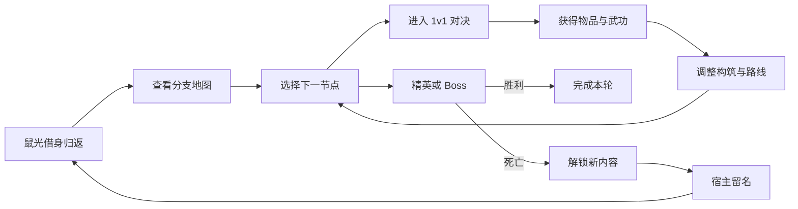

# 十二神相录：作品集概念设计案

## 文档信息

- **文档类型**：游戏策划作品集概念设计案
- **作者**：赵子杭
- **项目状态**：概念设计阶段
- **核心载体**：2D 横版 1v1 动作 Roguelite
- **封面宣传语**：天书无名，人间有相
- **文档目的**：证明设计目标的清晰度、系统之间的联动能力、关卡表达能力和范围控制能力

---

## 1. 项目摘要

《十二神相录》是一款以十二生肖角色差异为核心的 2D 横版 1v1 动作游戏。主线围绕冷峻、寡言的鼠光展开。他与其余十一名生肖英雄在天庭镇压中全部阵亡，随后通过阎王的还魂契回到天路。第一次回归使用自己的身体，后续每一轮则借用一名仍活着的承愿者。玩家在分支地图上选择路线，与普通敌人、精英和 Boss 进行对决，并通过武器、武功秘籍、防具和信物形成单局构筑。

死亡不会提供永久数值成长。玩家保留的是新解锁的区域、武器、秘籍、敌人和自身积累的战斗经验。若某名承愿者的身体被留在天路，且未得到释放，后续轮回中可能生成可选的“旧我”精英；它不保证出现，也不是普通流程必须处理的内容。击败旧我可以释放宿主灵魂并获得隐藏结局相关证词。

项目的核心玩家幻想是：

> 用鼠光的武功与能力持续登天，在活体寄身与战斗记录中看清真相，并决定为了活着的百姓、已经牺牲的同伴和被困的承愿者战斗到什么程度。

### 1.1 目标体验

- **短而清晰的单场对决**：普通战斗节奏紧凑，敌人的意图和破绽可以被观察。
- **角色改变规则**：生肖不只是换皮，移动能力、特殊技能和关卡路线都会变化。
- **局内构筑持续变化**：武器提供基础连招，秘籍即时强化或改写招式。
- **失败产生新挑战**：死亡不只是回城，而是制造一个需要重新面对和利用的敌人。
- **重玩依靠理解**：玩家变强主要来自知识、操作和组合能力，而不是永久数值。

### 1.2 四条设计支柱

1. **角色就是规则**

   每个生肖的移动速度、跳跃能力、特殊技能和战斗距离不同。角色的能力必须改变玩家如何进出交战范围、如何处理地形，以及如何选择进攻时机。

2. **构筑发生在局内**

   武功秘籍拾取后立即生效。玩家无法在关卡开始前把所有流派规划完成，必须根据当前敌人在路线中临时调整。

3. **寄身产生道德代价**

   每轮使用一名仍活着的承愿者。鼠光最初以为这些身体已经死亡，后来才发现他们全程清醒；无论通关还是死亡，身体最终都会衰亡。未解脱的宿主可能成为隐藏结局中的旧我。

4. **对决必须可读**

   普通敌人使用单条生命，Boss 使用多阶段结构。所有高强度攻击都需要清楚的预备动作、范围提示和恢复窗口。

### 1.3 文档边界

本文档论证完整的设计愿景，不提出开发排期、人员配置或 Demo 功能承诺。角色、数值和关卡参数属于首版设计基线，用于说明系统如何工作，不代表最终实现数据。

---

## 2. 核心循环

### 2.1 单局循环



一局目标时长约为 60 至 120 分钟，固定经过 20 个节点。玩家在每个节点都要面对三层决策：

1. **战斗决策**：现在应该正面交换、拉开距离，还是切换武器创造克制。
2. **构筑决策**：新秘籍是否值得占用招式槽，是否替换现有能力。
3. **路线决策**：前往高收益节点、寻找商店，还是追踪可能出现的失名旧我并承担额外战斗风险。

### 2.2 单场对决循环

每场普通对决遵循以下节奏：

1. **观察**：辨认敌人武器、站位习惯和起手动作。
2. **试探**：通过移动、跳跃和轻攻击确认攻击距离。
3. **交换**：使用连招、防御、闪避和特殊技能争夺主动权。
4. **调整**：根据敌人变化切换武器或使用刚获得的武功。
5. **结算**：击败敌人后选择奖励，并回到地图继续做路线决策。

普通对决应控制在约 30 至 90 秒。精英与 Boss 可以延长节奏，但不能依赖单纯的数值堆叠。

### 2.3 失败循环

死亡或完成一轮后发生以下流程：

1. 玩家失去本轮携带的具体物品和临时强化。
2. 当前承愿者的身体随鼠光灵魂离开而衰亡。
3. 宿主被困的灵魂与鼠光的战斗记录被阎王保存。
4. 后续轮回可能生成可选“旧我”节点，概率受死亡区域、路线与已有证词影响。
5. 玩家击败旧我后，可以释放宿主灵魂并获得证词，但不能恢复本轮已失去的完整构筑。
6. 未出现的旧我不会自动占据普通节点；其宿主命运在结局中体现。

失败循环的价值不是回收装备，而是让玩家逐渐意识到每一轮都有活人付出代价。旧我是隐藏结局的重要线索来源，而不是普通构筑成长的必要步骤。

---

## 3. 游戏结构

### 3.1 单局地图

单局地图由 20 个节点组成，分为无雨乡、罡风隘、天河录库和玉京天阙四个大区域，每区固定 5 个节点。罡风隘与天河录库可以交换顺序，玩家可以在区域内部选择不同分支，但不会看到所有节点的完整奖励。区域通关后永久解锁下一层，并扩展奖励池；后续轮回仍从无雨乡开始。正常主线目标为 3–5 轮。

节点类型包括：

| 节点类型 | 主要作用 | 玩家决策 |
| --- | --- | --- |
| 普通对决 | 进行单血条 1v1 战斗 | 是否需要冒险换取成长 |
| 精英对决 | 高强度敌人；部分路线可能出现失名旧我 | 构筑是否足以应对，隐藏证词是否值得追查 |
| 奇遇事件 | 提供风险交换或规则变化 | 是否牺牲当前资源换取未来能力 |
| 商店 | 购买武器、秘籍或恢复资源 | 是否为当前流派投入资源 |
| Boss | 多阶段高强度战斗，阶段数按敌人配置 | 是否已经具备稳定应对手段 |

### 3.2 路线设计原则

- 每条路线都应有可识别的风险与收益差异。
- 失名旧我所在节点必须可到达，但不会保证出现，也不能总在最低风险路线上。
- 玩家应能在进入节点前判断大致风险，而不是完全随机受罚。
- 路线不能只提供奖励选择，也要改变战斗环境和敌人类型。
- 同一节点应允许不同生肖找到不同解法，但不能让单一能力无条件跳过全部挑战。

### 3.3 一局的结束条件

- **胜利**：击败本层 Boss，完成本轮。
- **死亡**：生命归零，当前承愿者身体衰亡，鼠光返回冥府。
- **胜利**：击败区域 Boss 后继续登天；完成整轮时当前承愿者身体同样衰亡。
- **主动放弃**：保留已解锁内容，但当前承愿者仍会被阎王记录，不能通过反复放弃规避代价。

### 3.4 区域解锁与奖励池

- 无雨乡是每轮起点，使用基础武器、民间拳法、旧甲和家传信物。
- 罡风隘增加机动、高空格斗、关隘控制和反空类物品。
- 天河录库增加天庭兵械、记录型信物、武器切换与克制类能力。
- 玉京天阙增加权柄、领域规则和终局构筑物品。
- 已解锁区域不会让玩家跳过低层路线，但对应物品会进入此前未锁区域的奖励池。
- 高区域物品主要提供新机制与流派，不通过数值碾压使低区域物品失去意义。

---

## 4. 生肖角色系统

### 4.1 共同动作框架

所有生肖共享一套基础动作，确保敌人和关卡可以建立统一规则：

- 左右移动
- 跳跃
- 普通攻击
- 上段、下段、跳跃攻击的基本分类
- 防御或精准格挡
- 闪避
- 武器切换
- 武功招式

不同生肖改变这些动作的数值、节奏和特殊规则，而不是从零建立一套完全不同的操作方案。

主线固定使用鼠光。其余生肖通过剧情人物、旧我敌人、小神仙事件和轮回试炼出现；其中所有生肖都拥有固定能力的试炼，只有少量角色拥有简短个人支线。

### 4.2 角色差异维度

| 维度 | 定义 | 对关卡的影响 |
| --- | --- | --- |
| 移动速度 | 基础位移与追击能力 | 影响敌人站位和竞技场宽度 |
| 跳跃高度 | 垂直机动能力 | 影响平台高度和空中攻击入口 |
| 攻击距离 | 近身、中距或远程倾向 | 影响敌人的近身压迫强度 |
| 生存能力 | 生命、受击硬直、防御效率 | 影响容错和资源交换方式 |
| 特殊资源 | 施放核心技能所需的资源 | 限制强力能力的使用频率 |
| 特殊技能 | 改变移动或交战规则的主动能力 | 决定专属路线和战术解法 |

### 4.3 代表角色：鼠

**战斗定位**：高速近身角色，擅长短距离突袭与绕后。

**特殊能力：打洞**

- 鼠只能进入预先标记的软土、墙脚或地洞。
- 打洞消耗专用资源，不能无限停留在地下。
- 出口必须在进入前可识别，避免形成无法反制的随机偷袭。
- 敌人可以用范围攻击、地刺或预判攻击封锁出口。

**关卡影响**：鼠可以把侧向地洞作为绕过正面防线的手段，但出口位置固定，因此关卡设计师可以同时给予优势和控制风险。

### 4.4 代表角色：龙

**战斗定位**：高机动空战角色，擅长从高处施加压力并重新选择交战距离。

**特殊能力：飞行**

- 持续飞行消耗气力，气力耗尽后只能短暂滑翔。
- 竞技场可以设置天花板、飞镖、空中陷阱或强风区限制飞行路线。
- 龙在空中仍会受到清晰可读的反空攻击威胁。

**关卡影响**：龙可以跨越地面障碍并从上路进攻，但必须管理气力和空中安全区。关卡不能仅靠取消飞行来平衡，而应通过空间规则形成取舍。

### 4.5 平衡原则

- 数值差异控制角色倾向，特殊能力决定角色解关方式。
- 强力移动能力必须附带资源、空间或时间成本。
- 每个生肖都应有至少一种处理近战压迫和远程压制的手段。
- 角色强度不能只通过永久数值成长修正，避免死亡循环变成刷属性。

---

## 5. 战斗设计

### 5.1 战斗空间

每场战斗位于一屏横版竞技场内。竞技场可以包含：

- 地面主战区
- 一至两层平台
- 固定或周期触发的环境机关
- 角色专属路线，例如鼠的地洞或龙的穿越空域
- 明确的左右边界和场地状态变化

双方可以变换左右位置。镜头保持竞技场稳定，避免频繁跟随造成攻击提示和走位信息丢失。

### 5.2 普通敌人

普通敌人使用单条生命，原则上具有：

- 一到两个明确的进攻起手
- 一个需要玩家处理的防守习惯
- 一个在低生命时出现的可预期变化
- 失败后的清晰恢复窗口

普通敌人的职责是测试玩家当前构筑，而不是消耗大量时间。

### 5.3 精英与失名旧我

精英敌人可以组合普通敌人的行为模块，但不会直接复制多阶段 Boss 的长度。失名旧我属于可选特殊精英，不保证出现在普通路线中，需要遵守以下公平规则：

- 只继承上一轮中可观察的部分能力、物品和三种行为习惯。
- 不继承可能导致无预警秒杀的最强组合。
- 继承内容应通过外观、武器或起手动作提前表达。
- 击败后释放被困宿主的灵魂，并提供隐藏结局证词；不用于补回普通构筑损失。

### 5.4 Boss 结构

Boss 使用三个明确阶段。阶段变化可以由生命阈值、场地变化或招式解锁触发。

每个阶段需要回答一个不同问题：

1. **基础熟练度**：玩家是否掌握移动、防御、闪避和攻击窗口。
2. **构筑适应力**：玩家是否能根据敌人大幅改变的战斗方式切换武器或招式。
3. **综合运用**：玩家是否同时管理场地、资源和上一阶段形成的风险。

### 5.5 战斗可读性

- 高强度攻击必须拥有独特预备动作和明确范围。
- 攻击颜色、动作轮廓和音效提示应保持跨敌人一致。
- 同类攻击在不同角色和不同生肖间不能使用相互冲突的视觉语言。
- 屏幕特效不能遮挡角色脚部、武器轨迹和关键起手。

---

## 6. 构筑与物品系统

### 6.1 物品分类

| 类别 | 作用 | 获取方式 | 是否跨局保留 |
| --- | --- | --- | --- |
| 武器 | 决定基础连招、攻击距离和节奏 | 战斗奖励、商店 | 否，只解锁内容 |
| 武功秘籍 | 提供主动招式或改写连招 | 敌人掉落、奇遇 | 否，只解锁内容 |
| 防具 | 改变防御、硬直和生存规则 | 精英奖励、商店 | 否 |
| 信物 | 提供特殊规则和组合条件 | 奇遇、Boss 奖励 | 否 |

### 6.2 武器系统

- 玩家同时携带 2 把武器。
- 每把武器拥有独立的普通攻击连段和攻击距离。
- 切换武器有冷却，受击硬直中不能切换。
- 不同武器应形成节奏差异，例如快速连续、重击破防、长距离牵制。
- 武器之间可以通过招式衔接和状态叠加形成组合，但不能产生无限连段。

### 6.3 武功秘籍

武功秘籍采用局内即时生效规则：

- 拾取后立刻可以使用。
- 玩家最多保留 3 个主动招式。
- 招式槽已满时，玩家可以替换已有招式或放弃新招式。
- 部分秘籍提供被动修改，例如改变普攻收招、增加跳跃攻击效果或强化武器切换后的下一次攻击。
- 同一秘籍可以改变角色能力，但不能覆盖生肖的核心移动特征。

### 6.4 构筑目标

构筑选择需要同时考虑以下因素：

- 当前武器的攻击距离和连招速度
- 已获得秘籍之间的招式衔接
- 敌人的防御习惯与阶段变化
- 下一节点的路线风险
- 可能出现的失名旧我所继承的能力

玩家的目标不是单纯叠加最高伤害，而是形成能够应对多种战斗问题的组合。

---

## 7. 活体寄身与失名旧我系统

### 7.1 活体寄身

第一次还魂使用鼠光自己的身体。他再次死亡后，原身体无法继续承载灵魂，阎王便安排“承愿者”轮流献出身体。

- 公开称呼为承愿者，强调自愿帮助十二生肖。
- 阎王内部称他们为“活借”。
- 系统统一使用“寄身者”解释机制。
- 承愿者仍然活着，意识全程清醒，能感受疼痛与死亡，但无法控制身体。
- 他们被告知灵魂只会沉睡，鼠光成功后仍能醒来。
- 鼠光被告知使用的是已经死亡的身体，因此不知道活人被压抑在体内。
- 无论通关还是死亡，身体最终都会衰亡；鼠光直到阎王背叛后才得知真相。

### 7.2 战斗记录

阎王只记录三类容易观察的习惯：

- 常用攻击距离
- 连招偏好
- 闪避方向

普通旧我只使用上一轮数据；最终 Boss 才会整合全部轮回记录。游戏不显示判录 UI，但旧我会通过待机动作、连招轨迹、闪避方向和武器切换暴露模仿痕迹。

### 7.3 失名旧我

失名旧我不是普通流程必须处理的死亡回收机制，也不保证出现在正常对局中。

- 当承愿者的身体被留在天路且未获释放时，他会进入后续可选精英节点池。
- 出现概率受死亡区域、当前路线和已有证词数量影响。
- 玩家可通过特定路线主动提高追查概率。
- 击败旧我后，被困宿主的灵魂获释，并提供隐藏结局相关证词。
- 未出现的旧我不会自动占用普通节点，其宿主命运会在结局中体现。
- 旧我属于隐藏结局的可选证词来源，不是解锁断轮门的必要条件。

### 7.4 公平规则

- 旧我不会继承无预警秒杀能力。
- 它的强度与死亡节点难度相关，不随玩家等级无限增长。
- 它可以使用死亡场地的机关，但不能生成超出该节点规则的新机关。
- 它只模仿三种行为习惯，不模拟玩家的完整操作水平。
- 玩家主动改变行为，就能利用旧我的过时判断制造空档。

### 7.5 设计目的

活体寄身把每一次轮回都变成道德代价，旧我则把玩家过去的打法变成隐藏结局中的悲剧线索。玩家不是为了回收装备而追查旧我，而是为了确认那些身体究竟属于谁、他们是否还能得到解脱。

---

## 8. 关卡设计

### 8.1 关卡设计目标

关卡不是让玩家从入口跑到出口，而是让一场 1v1 对决在不同空间规则下产生变化。设计重点包括：

- 交战距离如何被地形改变
- 生肖能力如何提供不同路线，但不取消战斗
- 场地机关如何影响双方，而不是只伤害敌人
- 玩家如何读取风险、选择站位和决定是否切换武器
- 可选旧我如何利用原场地的规则形成可预测的新压力

### 8.2 竞技场结构语法

一个完整竞技场由以下元素构成：

| 元素 | 作用 |
| --- | --- |
| 主战区 | 保证 1v1 正面交锋空间 |
| 垂直层 | 提供高低差和空中攻击路线 |
| 专属通道 | 鼠、龙等角色使用的高收益路线 |
| 环境机关 | 周期性改变安全区或站位 |
| 边界 | 定义战斗范围并限制无限脱离 |
| 可破坏结构 | 随战斗推进改变空间关系 |

### 8.3 普通关卡案例：悬索擂台

**设计目的**

悬索擂台用于教学“角色能力与路线选择”的关系。它是一座一屏横版竞技场，敌人使用单条生命。

**空间结构**

```text
                  上层平台
        [平台 A] ------------ [平台 B]

      地面主战区
  ================================
  鼠类地洞入口                 鼠类地洞出口
```

**场地元素**

- 地面主战区保持开阔，确保正面对决不会被平台切碎。
- 上层平台提供远程压制角度，但近战追击的落地时间更长。
- 左侧存在鼠类地洞入口，出口位于敌人侧后方。
- 出口有可识别标记，敌人可以尝试预判或使用范围攻击封锁。
- 龙可以飞越地面障碍，但空中存在飞镖触发区和有限高度。

**战斗过程**

1. 玩家与敌人从地面开始，先确认攻击距离和防御方式。
2. 敌人使用水平突进迫使玩家跳上平台或改变站位。
3. 鼠可以选择钻洞绕后，但必须承担出口被预判的风险。
4. 龙可以取得空中位置优势，但需要管理气力和反空威胁。
5. 击败敌人后，奖励出现在场地一侧，玩家决定是否冒险拾取。

**设计验证问题**

- 鼠和龙是否都能利用场地，但不会自动跳过整场战斗？
- 其他角色是否仍能通过基础平台、跳跃和武器切换处理同类问题？
- 敌人是否会对不同高度和绕后路线做出可理解的回应？

### 8.4 Boss 关卡案例：削名判官

**设计目的**

削名判官驻守天河录库，负责抹除失踪者、承愿者和反抗者的姓名。他测试玩家是否能在部分构筑被临时封锁时继续战斗，同时让玩家提前看到“阎王正在记录玩家”的异常。

他拥有三个明确阶段：

| 阶段 | 设计问题 | 主要变化 | 玩家应对 |
| --- | --- | --- | --- |
| 第一阶段：录名 | 玩家是否认识自己的构筑重心 | 判官观察常用武器和武功，在卷宗中写下名字 | 主动使用不同能力分散记录 |
| 第二阶段：削名 | 玩家是否能处理临时封锁 | 最多封锁一个武器槽或一个主动招式 | 击破场地封条并恢复能力 |
| 第三阶段：判词成真 | 玩家是否能同时理解场地与招式规则 | 写下最多两条判词，例如禁跳、封兵、落判 | 击破对应封条推翻判词 |

**判词规则**

- 同时最多存在两条判词，第三条出现时替换最早的一条。
- 判词必须有明确文字、颜色和场地标记。
- 不能封锁玩家唯一的生存手段或全部主动能力。
- 每条判词都有至少一种可执行的破除方式。
- 判词只影响场地与构筑，不直接读取玩家输入。

**场地变化**

- 第一阶段保持开阔地面，让玩家观察卷宗和判官动作。
- 第二阶段漂浮封条进入场地，玩家需要在进攻与解除封锁之间取舍。
- 第三阶段卷宗遮挡部分平台，判词改变安全区、跳跃和武器可用性。
- 场地机关对双方生效，判官完成判词时也有明确停顿。

**失败反馈**

- 第一阶段失败主要来自没有理解被记录的是最常用能力。
- 第二阶段失败主要来自忽略封条，继续依赖已封锁构筑。
- 第三阶段失败主要来自同时处理两条判词时站位失控。

玩家失败后应能明确指出自己要破除哪条判词或改变哪套连招，而不是只感觉能力被随机禁用。

### 8.5 系统与关卡的对应关系

| 系统 | 在关卡中的表达 |
| --- | --- |
| 生肖数值 | 位移速度、跳跃高度和攻击距离改变安全区 |
| 特殊技能 | 鼠的地洞、龙的飞行生成专属路线 |
| 武器切换 | 不同高度和敌人阶段需要不同攻击距离 |
| 武功秘籍 | 特定组合可以打开更快的胜利路径 |
| 失名旧我 | 可选精英沿用原场地规则，并作为隐藏结局证词来源 |
| 环境机关 | 改变站位、资源和攻防节奏 |

---

## 9. 作品集呈现方式

### 9.1 面试官阅读路径

作品集需要让面试官在 5 分钟内理解以下内容：

1. 游戏是什么。
2. 玩家反复做什么。
3. 系统之间如何互相影响。
4. 一个关卡如何具体工作。
5. 设计者做了哪些取舍。

正文按以下顺序组织：

1. 一页项目摘要
2. 目标体验和四条设计支柱
3. 核心循环图
4. 生肖、战斗、构筑和活体寄身系统
5. 悬索擂台关卡案例
6. 削名判官 Boss 案例
7. 关键设计取舍
8. 十二生肖概念矩阵

### 9.2 必备视觉材料

- 单局核心循环图
- 系统关系图
- 悬索擂台空间示意图
- 削名判官三阶段变化图
- 生肖能力与关卡路线对照表
- 活体寄身与失名旧我流程图

### 9.3 作品集证据原则

- 不把设计设想写成已经完成的游戏功能。
- 不虚构试玩数据、用户反馈或开发成果。
- 数值明确标注为首版设计基线。
- 设计结论要说明依据、取舍和可能风险。
- 每张图只表达一个主要关系，避免为了视觉效果降低可读性。

---

## 10. 关键设计取舍

### 10.1 为什么采用分支地图

分支地图让玩家在进入战斗前就能做出风险选择。它连接战斗、奖励和隐藏证词追查，不只是改变关卡顺序。

### 10.2 为什么秘籍局内即时生效

即时生效强化临场调整和路线价值。玩家不能依赖关卡外的固定流派配置，因此每次拾取都可能改变后续决策。

### 10.3 为什么不保留永久属性成长

永久数值成长会削弱操作和知识带来的反馈，也会让活体寄身的道德代价失去意义。长期进度只扩大可选内容，不直接提高战斗胜率。

### 10.4 为什么旧我不是必然出现

如果旧我每次死亡后都强制出现，它就会成为普通玩法步骤，而不是阎王隐瞒真相的证据。改为可选、概率受路线影响的精英后，它更适合承担隐藏结局证词与宿主救赎线。

### 10.5 为什么限制鼠和龙的移动能力

打洞和飞行如果无成本使用，会绕过大部分关卡设计。资源消耗、固定出口、反空区和场地结构可以保留角色幻想，同时维持 1v1 对决的核心地位。

---

## 11. 风险与设计验证

### 11.1 角色数量与差异化压力

**风险**：十二生肖全部拥有独立数值、技能、动画和关卡适配，内容规模过大。

**控制方式**：

- 所有角色共用动作框架。
- 角色差异集中在数值、一个特殊能力和少量招式改写。
- 关卡使用统一结构语法，只增加角色专属路线。
- 完整概念先按角色功能原型分类，再逐步深化。

### 11.2 飞行能力破坏关卡

**风险**：龙可以绕过地面规则，使关卡失去意义。

**控制方式**：

- 飞行消耗气力。
- 空中存在反空攻击和区域限制。
- 地面路线提供不同收益，不能只把飞行视为劣势。
- 关卡同时测试空中生存和落地后的近战处理。

### 11.3 格斗式 AI 的制作难度

**风险**：敌人需要同时处理距离、出招、防御、平台和角色能力，行为复杂度很高。

**控制方式**：

- 普通敌人只使用少量可组合的行为模块。
- 通过起手、恢复和状态切换建立可读规则。
- 失名旧我复用现有行为模块，不单独建立玩家操作模拟系统。
- Boss 按阶段逐步开放能力，不做全程自由随机行为。

### 11.4 活体寄身与旧我的叙事压力

**风险**：承愿者全程清醒的设定可能让玩家觉得自己无论输赢都在伤害无辜者，持续游玩产生压抑或抗拒。

**控制方式**：

- 前期只给出暧昧异常，不让鼠光和玩家立即承担完整真相。
- 旧我属于可选内容，不作为普通构筑成长的必要条件。
- 每一个被释放的宿主都有明确反馈，避免玩家觉得行动完全没有意义。
- 隐藏结局释放所有被困灵魂，让持续追查得到实际回报。
- 正常结局保留无法挽回的损失，但不把问题包装成玩家的主动恶意。

### 11.5 构筑可读性

**风险**：武器、秘籍、防具和信物同时作用，玩家难以理解自己的能力。

**控制方式**：

- 物品效果围绕少量明确标签建立。
- 战斗界面只显示当前主动招式与关键状态。
- 拾取时直接显示替换关系和连招变化。
- 关卡案例优先展示最重要的两到三条组合，不堆叠隐藏效果。

### 11.6 后续设计验证问题

在不承诺开发内容的前提下，后续应优先验证：

1. 普通对决是否能在 30 至 90 秒内形成完整攻防判断。
2. 鼠和龙是否能在同一竞技场中形成明显不同但都可理解的解法。
3. 玩家能否在拾取秘籍后立即说明自己的招式发生了什么变化。
4. 可选旧我是否容易被识别为“上一轮的自己”，而不是普通精英换皮。
5. 玩家是否愿意为了释放宿主和隐藏证词主动选择更高风险路线。

---

## 12. 世界观与双终局

### 12.1 核心冲突

天庭统治三界，却把凡人视为维持秩序的成本。十二生肖不是天庭敕封的神将，而是代表农户、百姓和普通劳动者的民间抵抗者。他们从不同方向共同进攻天庭，最终全部阵亡。

主线固定围绕鼠光展开。他性格冷峻、寡言，因为长期目睹天庭漠视凡人，所以不相信权力、口头承诺和“为了大局”的说法。他仍然会主动保护具体的人，但并不通过热血演讲表达理想。

兔昭是鼠光唯一愿意破例信任的朋友。她主动接近鼠光，相信反抗能够带来更好的未来。两人在同一场战斗中先后死亡，兔昭的死亡让鼠光更加封闭，也让他把复仇和继续登天误当成纪念朋友的方式。

### 12.2 三层真相

1. **玩家认知**：阎王用一次性还魂契把鼠光送回天路，是唯一愿意帮助十二生肖的神。
2. **隐藏真相**：第一次还魂使用鼠光自己的身体；后续回归使用仍然活着的承愿者。他们意识清醒却无法控制身体，无论通关还是死亡，身体最终都会衰亡。
3. **最终目的**：阎王从未想帮助民间，他利用十二生肖削弱天庭、收集战斗数据，准备取代玉皇。

阎王选择鼠光，是因为他重情、痛苦且愿意独自承担目标，比其他人更容易被操纵。兔昭保护小神后灵魂出现异常，阎王无法稳定控制她，因此没有把她送回。鼠光被告知后续使用的是已经死亡的身体，直到阎王背叛后才知道承愿者全程清醒。

### 12.3 剧情与玩家认知的错位

- 第一次完整轮回结束后保证出现一次剧情旧我，使用许安的身体；玩家可以战斗或绕开。此后旧我并非每轮都会出现。
- 兔昭的短章补全同一场战斗的后半段，让玩家知道两人都已经死亡。
- 猴影的支线保留发现十二生肖战斗档案的版本，可能让玩家提前猜到记录用途。
- 玄简被阎王扣押生死簿页，被迫监视鼠光；他同时暗中保存生肖真名和兔昭残页。
- 部分小神仙事件涉及姓名、承愿者、战斗记录和阎王，结果会写入“轮回见闻”。
- 玩家帮助、威胁或无视小神仙后，其状态跨轮回保留，影响后续路线、人物命运和线索获取。

### 12.4 叙事结构

| 阶段 | 表层事件 | 玩家逐渐发现的内容 |
| --- | --- | --- |
| 序章：登天 | 十二生肖共同进攻天庭，鼠光与兔昭先后战死 | 阎王提出一次性还魂契 |
| 第一幕：借身归返 | 鼠光通过还魂契重新登天 | 保底旧我复现鼠光的距离、连招和闪避方向 |
| 第二幕：异样 | 战斗记录、小神仙事件与兔昭短章逐步出现 | 敌人复现三种玩家习惯，承愿者也出现含糊异常 |
| 第三幕：假胜利 | 玉皇揭露自己一直放任鼠光，随后战败 | 阎王早有预谋，借还魂契夺走玉皇力量 |
| 终幕：断轮 | 玩家在正常终局或断轮终局之间完成收束 | 阎王能复制行为，却不能复制鼠光改变自己的选择 |

兔昭短章只在返回冥府或区域结算后触发，不打断战斗。主线流程不强制增加其他生肖短章，其他角色通过轮回试炼和旧我战斗补充群像。

### 12.5 正常结局

- 玉皇在战前揭露自己把鼠光当作诱饵，想借此逼阎王暴露。
- 鼠光亲手杀死玉皇，阎王证明自己早有预谋，并顺着还魂契吸收其神魂与权柄。
- 玄简牺牲自己的生死簿页，把鼠光从契约中拉出，留下残缺警告后消失。
- 最终战分三阶段：玉皇神权、十二生肖旧相、根据玩家习惯进行判录。
- 鼠光击败阎王，但失控的轮回力量将两人一同吞没。
- 天庭崩解，百姓摆脱压迫，但战争造成大量伤亡。
- 轮回结构崩毁后只有少数被困承愿者灵魂逃出，多数人仍随冥府崩坏而失散。
- 兔昭与部分残魂没有得到解脱，鼠光也无法回到人间。
- 百姓只记得十二生肖的故事，最终形成《十二神相录》。

### 12.6 隐藏路线：断轮

关键轮回证词集齐后，冥府结算界面出现“断轮门”。玩家可以主动撕毁还魂契，在阎王吸收玉皇前提前宣战。

断轮路线包含以下规则：

- 提前面对的阎王尚未获得玉皇力量，只使用轮回簿和部分生肖数据，战斗分两个阶段。
- 击败阎王后获得“断轮印”。它附着于所有武器，不占用武器槽，也不提供高额数值。
- 断轮印可以破除神力护盾、复活、无法选中和强制锁阶段。
- 玩家必须从无雨乡开始，以一条命连续完成 20 个节点。
- 每击败区域 Boss 只恢复部分生命，生命跨节点继承，死亡后挑战失败。
- 死亡会回到断轮门，保留证词但失去断轮印；击败缩短版阎王残念后可以重试。
- 失名旧我只提供额外证词和宿主故事，不是进入断轮门的必要条件。

### 12.7 隐藏结局

- 鼠光在断轮印加持下击败玉皇，但选择剥夺并封印其权柄，不杀死他。
- 以玉皇为首的压迫秩序被终止，更多人得以存活。
- 兔昭的残魂获释，可以正常进入轮回；鼠光亲手送她离开。
- 未被使用的承愿者回到人间，所有仍被困的灵魂获释并进入轮回。
- 最终寄身者春生的身体仍然死亡，但断轮印保住其灵魂，使其能够正常轮回。
- 玄简保住姓名，但失去原本的冥府神职。
- 鼠光因断轮印与生死秩序绑定，无法恢复普通生活，选择留在冥府守望轮回。
- 隐藏结局不是无代价的完美结局。已经死亡的承愿者无法复生，鼠光仍承担自己不知情参与活借的责任。

### 12.8 十二生肖角色表

| 生肖 | 姓名 | 角色定位 | 反抗军职责或主题 |
| --- | --- | --- | --- |
| 鼠 | 鼠光 | 主线主角 | 冷峻、寡言，为百姓持续登天 |
| 牛 | 牛贵 | 支线 / 试炼 | 代表农户与普通百姓 |
| 虎 | 虎大 | 支线 / 试炼 | 代表反抗军内部理念冲突 |
| 兔 | 兔昭 | 情感短章 | 鼠光的挚友，相信未来 |
| 龙 | 龙远 | 试炼 / 剧情 | 高空侦察与云路穿越 |
| 蛇 | 蛇牙 | 支线 / 试炼 | 最早怀疑阎王的人 |
| 马 | 马顺 | 试炼 / 剧情 | 运送伤员与百姓，熟悉撤离路线 |
| 羊 | 羊宁 | 试炼 / 剧情 | 管理庇护所与药物 |
| 猴 | 猴影 | 支线 / 试炼 | 独行侦察者与复制悲剧 |
| 鸡 | 鸡晓 | 试炼 / 剧情 | 预警与号令传递 |
| 狗 | 狗安 | 试炼 / 剧情 | 追查失踪者与伪造记录 |
| 猪 | 猪满 | 试炼 / 剧情 | 管理粮食与装备补给 |

### 12.9 轮回试炼

- 额外生肖全部拥有固定能力试炼，但不承担主线结局。
- 主线遇到生肖复制体后获得“战法残卷”，随后在冥府点亮对应试炼。
- 复制体位于可选精英节点，错过后可从统一试炼池补获，不会永久缺失。
- 四个拥有简短支线的角色是牛贵、蛇牙、虎大和猴影。
- 支线只补充角色动机、死亡经过和世界细节，不改变主线结果。
- 击败复制体并完成试炼后，解锁该生肖在试炼模式中的可玩资格和角色档案。

## 13. 十二生肖概念矩阵

下表用于展示十二生肖的功能定位与关卡影响方向。它是完整愿景的功能框架，不是已经确定的最终能力列表。

| 生肖 | 战斗倾向 | 特殊能力命题 | 主要关卡影响 |
| --- | --- | --- | --- |
| 鼠 | 高速近身、绕后 | 进入标记地洞 | 侧向路线与出口预判 |
| 牛 | 重装近战、正面压迫 | 蓄力冲撞与霸体 | 破墙、直线压制和高风险起手 |
| 虎 | 强攻、短距爆发 | 突进扑击与反击 | 快速拉近与惩罚远程动作 |
| 兔 | 高机动、诱骗 | 多段跳跃与假动作 | 高平台与快速脱离 |
| 龙 | 空中压制、机动 | 消耗气力飞行 | 空域、反空区与高度控制 |
| 蛇 | 中距控制、持续伤害 | 低姿滑行与束缚 | 地面封锁与狭窄区域 |
| 马 | 长距冲刺、节奏连段 | 冲锋叠加动势 | 长距离追击与直线场地 |
| 羊 | 防守反击、空间稳定 | 角撞格挡与推开 | 边界控制和保护狭窄平台 |
| 猴 | 空中连段、武器变化 | 攀越与招式复制 | 多层平台和连招实验 |
| 鸡 | 短距飞行、先手压制 | 滞空与声波标记 | 垂直预警和起手打断 |
| 狗 | 稳健追击、反制 | 追踪信物与防守反击 | 隐藏目标与反向利用投掷物 |
| 猪 | 生存、资源交换 | 承受伤害换取强化 | 高风险机关与资源管理 |

## 附录：核心术语

- **承愿者**：公开称呼，指自愿把身体借给鼠光的活人。他们全程清醒，但无法控制身体。
- **活借**：阎王内部对活体寄身和承愿者的称呼，带有物化意味。
- **寄身者**：系统用词，统称被鼠光灵魂寄宿的活体身体。
- **失名旧我**：承愿者身体与鼠光战斗记录形成的可选精英，不保证出现，并关联隐藏结局证词。
- **武功秘籍**：局内拾取并立即生效的主动招式或连招改写能力。
- **设计基线**：用于说明系统运作方式的首版参数，后续可根据验证结果调整。
- **节点**：分支地图上的一次战斗、事件、商店或 Boss 遭遇。
- **竞技场语法**：构成 1v1 战斗空间的主战区、平台、专属路线、机关和边界规则。

---

## 14. Demo 纵向切片

**状态：已锁定**

正式 Demo 使用 Godot 4.7.2 制作，工程位于 `E:\twelfe`。首个可展示版本目标时长为 10–15 分钟，固定包含六个节点：

1. 序章契约。
2. 天兵教学。
3. 香火抉择。
4. 断雨校尉精英战。
5. 旧我战。
6. 夺愿神 Boss。

Demo 只使用鼠光、许安、无雨乡、短刃与长枪、天兵/镇守/法吏、旧我和夺愿神。不制作其他生肖可玩内容、完整四大区域、完整 20 节点或最终双终局。

## 15. Demo 战斗实现基线

- 生命归零后立即重试当前节点；生命跨节点继承。
- 防御、闪避和潜地消耗气；精准格挡返还气。
- 轻击、重击和格挡反击命中积累势；破势斩和破土上挑消耗势。
- 普通攻击可防御或精准格挡；红色攻击不可格挡。
- 受击分为僵直、击飞和倒地；支持倒地重击追击。
- 浮空追加预算为普通敌人 3 次、精英 2 次、Boss 1 次。
- 空中轻击沿用地面轻击逻辑；空中重击为砸地击。
- 连招采用两段共用起手，第二段后按轻重击和方向分支。
- 主地面可以自由潜地，不能从浮台或空中进入。
- 钻出无惩罚性硬直，可直接衔接破土上挑。
- 所有敌人都有气，气只随时间恢复，机关类敌人不进入 Demo。
- 旧我只复制上一战的距离、连招和闪避方向，不读取当前输入，不显示提示 UI。
- 夺愿神三阶段依次测试基础攻防、夺势护盾和反潜地。

## 16. 技术实现与交接

完整技术设计、工程结构、自动测试和任务状态见：

`E:\game plant\docs\superpowers\specs\2026-10-15-zodiac-demo-design.md`

新对话开始前应读取该文件顶部的 Cold Start 区域。当前 M0–M6 已完成，M7 正在补充表现与交付材料。

---

## 17. 当前可玩构建（2026-10-20）

**状态：已实现**

当前 Godot 版本已经从 Combat Lab 推进为可完整走通的六节点纵向切片：

- 固定流程：序章 → 天兵 → 香火选择 → 断雨校尉 → 旧我 → 夺愿神。
- 战斗结束播放胜利动画，再进入独立节点选择界面；选择前不生成下一场敌人。
- 玩家和当前敌人均显示生命、架势、气、势和状态名。
- 玩家攻击消耗势，气用于防御、闪避和潜地；势在非攻击状态缓慢恢复。
- 敌人普通受击包含水平击退和僵直。
- 命中停顿与镜头震动由 `AttackData` 驱动。
- 夺愿神包含夺势护盾、可破坏香炉和渐进的潜地反制。
- Windows 构建已验证启动。
- 工程内共有 32 个自动测试脚本，覆盖战斗、敌人、旧我、Boss 和流程。

剩余工作集中在 M7 表现层：基础音效、统一占位美术、演示视频与最终作品集截图。
